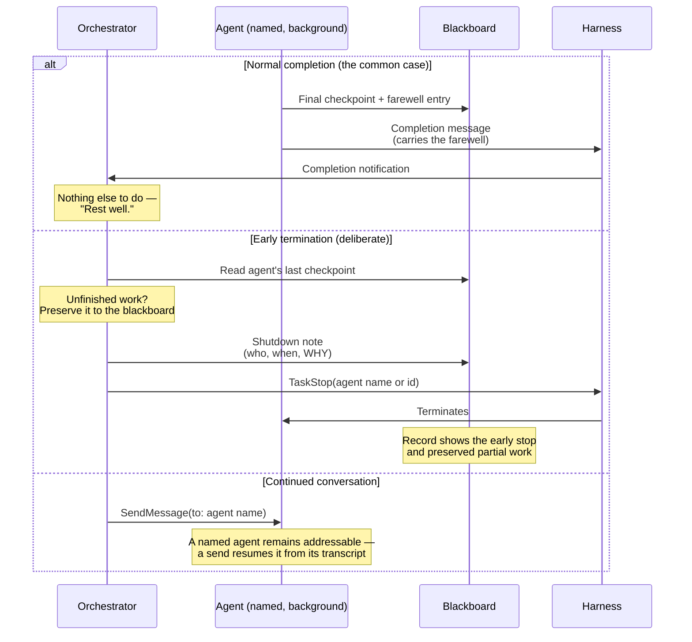

# Agent Shutdown

Agent shutdown follows the modern lifecycle in `protocols/agent-shutdown.md`. The normal case needs no ceremony: a background agent completes its charge, its farewell rides in its final completion message and last blackboard entry, and the harness notifies the spawner. Early termination is a deliberate act: the orchestrator checks the blackboard for an unfinished checkpoint, preserves any partial work, writes a shutdown note naming the reason, and only then calls `TaskStop`. No agent is silently killed mid-thought.

