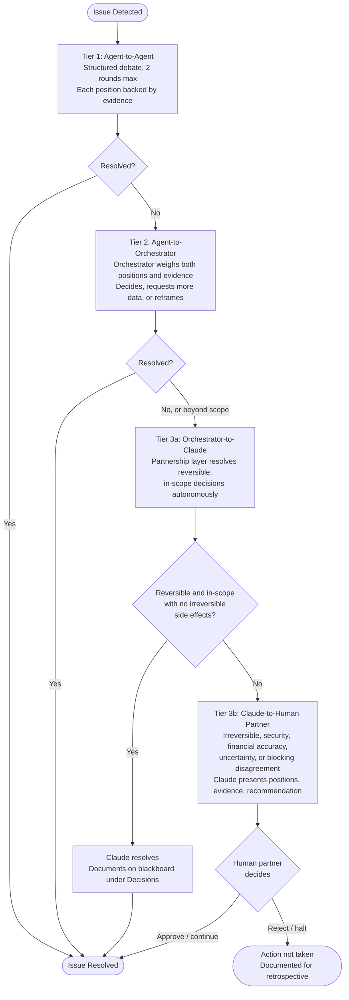

# Failure Escalation

When agents encounter disagreements or blocking issues, The Hive uses a four-tier partnership escalation path (see `protocols/escalation-rules.md`). Each tier attempts resolution before passing upward: routine disagreements resolve between agents (Tier 1), significant ones go to the Orchestrator (Tier 2), reversible in-scope decisions are resolved autonomously by Claude acting as the partnership layer (Tier 3a), and irreversible or high-stakes decisions require the human partner (Tier 3b).

